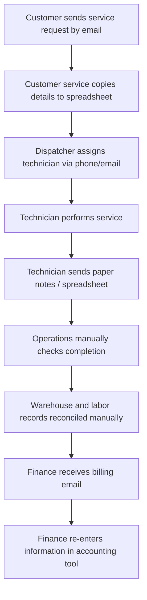

# AS-IS Process – Current State (Illustrative)

**Observed vs. assumed:** Every step shown is an **invented AS-IS scenario** for a fictional company. The diagram is not the outcome of real process observation.

See [process analysis](../04_process_analysis.md).
