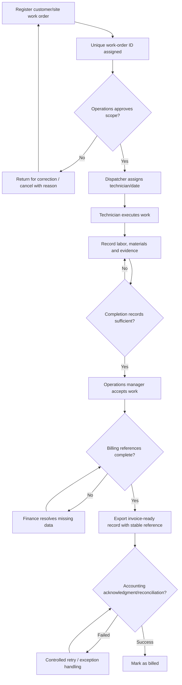

# TO-BE Process – Proposed Target State

**Status:** `DESIGN PROPOSAL`, not a validated, implemented or tested workflow. The exact acknowledgment and retry mechanism is **TO VERIFY** with the accounting system.

See [process analysis](../04_process_analysis.md) and [requirements](../03_requirements_catalogue.md).
